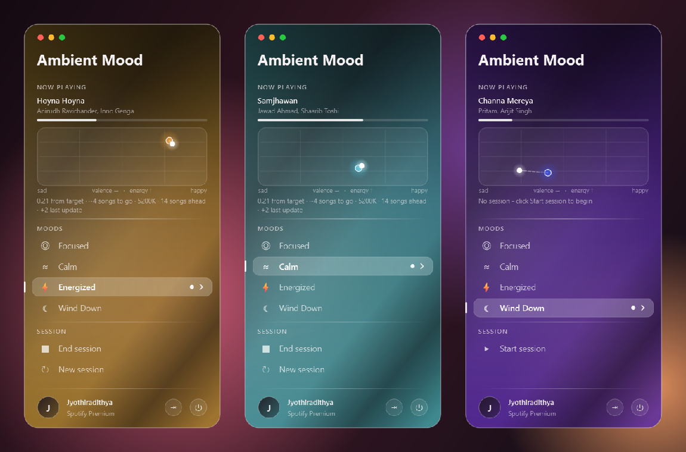

# Ambient Mood Regulator: User Manual

## 1. What it does

Ambient Mood Regulator works out your current mood from the music you play on Spotify, then slowly moves your surroundings toward a mood you pick.

Every song becomes a point on a 2D map:
- **Valence**: how positive or happy the music sounds, from 0 to 1.
- **Arousal (energy)**: how intense or active the music is, from 0 to 1.

**Your current mood is the average point of the songs in your queue**: the song playing now plus what's coming up.

You pick a **target mood** from the tray sidebar. The app then nudges you toward it in three ways:

| Area | What changes | How fast |
|---|---|---|
| 🎵 **Music** | Plays your queue from a private **"Ambient Mood session"** playlist. It adds songs a step closer to the target, in between your upcoming songs, and removes songs far from both your mood and the target. | Every 90 s and on each song change: at most 3 added and 2 removed, so the queue changes gradually |
| 🎨 **Themes** | Switches your VS Code theme and your Windows Terminal color scheme | As soon as you pick a mood |
| 🌡️ **Screen** | Makes the screen color warmer or cooler | 100 K per minute (gradual) |

It never interrupts what you're doing. It never pauses, skips or changes the song that's playing, and never touches the next song either. Podcasts are left alone and don't count toward your mood.

### The four moods

| Mood | Valence | Energy | VS Code theme | Terminal scheme | Screen |
|---|---|---|---|---|---|
| ◎ **Focused** | 0.50 | 0.45 | Default Dark Modern | Campbell | 5500 K |
| ≈ **Calm** | 0.60 | 0.25 | Quiet Light | One Half Light | 4500 K |
| ⚡ **Energized** | 0.80 | 0.85 | Monokai | Tango Dark | 6500 K (neutral) |
| ☾ **Wind Down** | 0.40 | 0.15 | Solarized Dark | Solarized Dark | 3500 K (warm) |

You can change any of these values in `config/config.json` (see §7).

---

## 2. How it fits together

```
 ┌──────────────────┐   writes target_mood    ┌──────────────┐
 │  Tray sidebar UI │ ──────────────────────▶ │ config.json  │
 │ (frontend/app.py)│                         └──────┬───────┘
 │                  │ ◀── reads data/state.json      │ file watcher (~50 ms)
 └──────────────────┘                                ▼
                                            ┌─────────────────────┐
   Spotify ◀── polls every 30–60 s ───────  │   Daemon            │
   queue   ◀── adds bridging tracks ──────  │ (backend/daemon.py) │
   VS Code / Terminal settings  ◀───────────│                     │
   Screen gamma                 ◀───────────│                     │
   data/mood.db (telemetry)     ◀───────────└─────────────────────┘
```

There are **two programs**, and each runs in its own terminal:
1. **The daemon** does the work: it reads Spotify, estimates your mood and makes the changes.
2. **The tray UI** is where you pick the target mood and see what's happening.

---

## 3. One-time setup

### 3.1 Python environment

You need Python 3.10 or newer from **python.org**. Don't use Anaconda's Python: its DLLs stop PyQt6 from loading.

Open PowerShell in the project folder and run:

```powershell
py -3.13 -m venv .venv
.venv\Scripts\python -m pip install -r requirements.txt
```

To check that everything installed correctly:

```powershell
.venv\Scripts\python -m pytest -q
```

The last line should say all tests passed (for example `85 passed`).

### 3.2 Create a Spotify developer app

You need **Spotify Premium**. Spotify only lets Premium accounts control the queue and playback through its API.

1. Go to <https://developer.spotify.com/dashboard> and log in.
2. Click **Create app**:
   - **App name / description:** anything, for example "Mood Regulator".
   - **Redirect URI:** `http://127.0.0.1:8888/callback`. Click **Add**, and type it exactly as shown.
   - **Which API/SDKs:** tick **Web API**.
3. Open the app and go to **Settings**. Copy the **Client ID**. You do **not** need the client secret: the app signs in with PKCE, which doesn't use one.
4. While the Spotify app is in *Development mode*, only accounts listed under **User Management** (up to 25) can sign in. Add each user's Spotify email there.

### 3.3 Set the Client ID

Put the Client ID in `config/config.json`:

```json
"spotify": {
  "client_id": "your_client_id_here",
  "redirect_uri": "http://127.0.0.1:8888/callback"
}
```

The Client ID is public (it identifies the app, not a person), so it's safe to ship with the app. Each user links their **own** Spotify account in the app's **Connect Spotify** window (§4), and their login is stored only on their computer in `data/spotify_accounts/`.

### 3.4 (Recommended) Import the track catalog

New songs are picked from your **top and saved tracks** plus a catalog of about 90,000 Spotify tracks. One command downloads the public *Spotify Tracks Dataset* (~20 MB) and imports it:

```powershell
.venv\Scripts\python -m backend.catalog import
.venv\Scripts\python -m backend.catalog stats     # check: "catalog: 89741 tracks"
```

Without it, only your own library is used. A small library leaves gaps in the mood map, so the app gets near the target but can't settle exactly. Your own songs still get a small preference over catalog songs.

### 3.5 (Optional) Allow warmer screen temperatures

By default, Windows won't let the screen go warmer than about 3400–4000 K. If you ask for warmer, the app goes as warm as Windows allows and logs a warning. To unlock the full range:

1. Press Win+R, type `regedit` and open
   `HKEY_LOCAL_MACHINE\SOFTWARE\Microsoft\Windows NT\CurrentVersion\ICM`
   (create the `ICM` key if it's missing).
2. Create a **DWORD (32-bit)** value named `GdiIcmGammaRange` and set it to `256` (decimal).
3. Sign out and back in.

### 3.6 Turn off Windows Night Light

Night Light also changes the screen color and would conflict with the app. Turn it off under Settings → System → Display → Night light.

---

## 4. Running it

### 4.1 The daemon

The tray UI (§4.2) starts the daemon itself once a Premium account is chosen, restarts it after a log-out or a crash, and stops it cleanly when you quit. Its log goes to `data/daemon.log`.

To see the log live while developing, start the UI with `--no-daemon` and run the daemon in its own terminal:

```powershell
.venv\Scripts\python -m frontend.app --no-daemon   # terminal 1
.venv\Scripts\python -m backend.daemon             # terminal 2
```

- Choose a Spotify account in the tray UI first: the daemon refuses to start until a Premium account is active. Only one live daemon can run at a time.
- Start playing music on any Spotify device: the desktop app, your phone or a web player.
- The terminal shows a log as things happen:

```
21:16:05 INFO    daemon: target mood: focused (0.50, 0.45) [startup]
21:16:05 INFO    backend.actuators.workspace: vscode theme -> Default Dark Modern (17 ms)
21:16:05 INFO    daemon: now playing Daft Punk - One More Time | mood (0.82, 0.78) | target focused
21:16:05 INFO    backend.actuators.audio: queued bridge Tame Impala - Borderline (v=0.74 e=0.70) toward waypoint (0.75, 0.75), deviation 0.46
21:19:40 INFO    daemon: finished Daft Punk - One More Time (none)
```

### 4.2 Start the tray UI

```powershell
.venv\Scripts\python -m frontend.app
```

First, the **Spotify account** window opens (every launch):

- **Accounts already linked on this computer** are listed. Click the one you want to use. The app checks it still has Premium, then continues.
- **Connect another account** (or **Connect Spotify** if none are linked yet) opens Spotify's sign-in page in your browser. Pick your account (use *Not you?* to switch) and click **Agree**.
- Only **Premium** accounts are linked. A free account gets *"You don't have Spotify Premium"* and nothing is saved; click **Use a different account** to try another.
- Closing the window without choosing an account quits the app.

Then a colored circle icon appears in the system tray, at the bottom-right of the taskbar. It may be hidden behind the **^** arrow; you can drag it out onto the taskbar.

> Tip: run `.venv\Scripts\pythonw -m frontend.app` instead to start the UI without a console window.

**Your account and Log out.** The sidebar's bottom row shows the Spotify account in use. Click its round **⇥** button, or right-click the tray icon and choose **Log out**, to forget that account on this computer. The account window opens again so you can pick another linked account or connect a new one.

### 4.3 Stopping

- **Daemon:** press **Ctrl+C** in its terminal. The screen color goes back to normal on exit.
- **Tray UI:** click **Quit** in the sidebar, or right-click the tray icon and choose **Quit**.

The two programs are independent: you can stop either one without affecting the other.

---

## 5. Using the sidebar

**Left-click the tray icon** to open the sidebar. Click anywhere else, or click the icon again, to close it.



```
Ambient Mood
NOW PLAYING
  ┌──────┐  Song
  │cover │  artist
  └──────┘  (pause) (next)
  ▬▬▬▬▬───────────── 1:23 / 4:49
  0.21 from target · ~4      ┌────────┐
  songs to go · 14 ahead     │○ ┄┄ ● │  small mood map
                             └────────┘
MOODS
  ◎ Focused
▌ ≈ Calm                     • ›   ← your target (pill); • = closest to how the music feels now
  ⚡ Energized
  ☾ Wind Down
SESSION
  ▶ Start session      (during a session: ■ End session, ↻ New session)
(J) Your name  Spotify Premium   ⇥ ⏻   ← Log out, Quit
```

| Control | What it does |
|---|---|
| **Pointer effects** | Move the pointer over the sidebar and it leaves soft waves in the glass, behind the text, that spread out and fade. Rows light up as you hover them and ripple when clicked; the selection slides to the mood you pick. The white dot on the mood map breathes gently. |
| **Glass colour** | Follows how your music feels right now: amber when happy and energetic, rose when tense, violet when sad, teal when calm (blends in between). It glides as your mood moves. |
| **Now playing** | The album cover, the song, the artist and a live progress bar with the time. They change within a second of a song change. |
| **Songs: …** | Where new songs come from. **For you** (the default) picks songs from your taste, mood and top languages. **Liked Songs** or **one of your playlists** uses only those songs, in any language, repeating them if needed. Click the row to choose. Only playlists you made are listed; Spotify doesn't let the app read playlists you only follow. If the playlist has nothing closer to your target, the sidebar tells you, and the mood stays as close as the playlist allows. |
| **Play/Pause, Next** | Control Spotify right from the sidebar. The button changes at once; Spotify follows within about half a second. Next counts as a skip. |
| **Mood map** (small, beside the status line) | The white dot is your current mood. The coloured dot is the target. The dashed line is the distance still to go. |
| **Status line** | The distance to the target, roughly how many songs it will take, the screen temperature, and the session's songs ahead / last changes (or a note such as "Preparing songs for you…"). |
| **Mood rows** | Click one to set your target. Within a second, the themes switch and the screen starts moving toward that mood's temperature. |
| **Start session** | Shown when no session runs (always at launch). First asks **where songs should come from** (For you, Liked Songs or one of your playlists) in a popup over the blurred sidebar; picking one starts the session at once (Esc or Cancel: nothing starts). Starts a session: themes and screen follow the target, and the app first prepares a pool of songs for you (your taste, your top-2 languages, the target mood). While it prepares, nothing is added to your music; your own queue keeps playing. Once the pool is ready, it starts adding songs. |
| **End session** | Ends the session: the next 10 songs go back to your normal queue, the session playlist is deleted, the song pool is cleared from disk, and the screen drifts back to neutral. |
| **New session** | Ends the current session (as above) and starts a new one with a fresh song pool. |
| **⇥ / ⏻** | Log out of Spotify on this computer / Quit the app (ends the session first). |

The **tray icon color** matches your current target mood. Hover over it to see the mood's name.

If the status card says **"Daemon not running"**, the daemon isn't running or hasn't updated in 5 minutes. Start it as described in §4.1.

---

## 6. What to expect day to day

### The session playlist
- **When it starts:** when you click **Start session** (or **New session**) while music is playing (or when you start playing). Your current song and your queue move into a private playlist, **Ambient Mood session**. The same song keeps playing from the same second.
- **Preparing:** first the app fills a song pool for the target in the background (usually a few minutes; the sidebar shows "Preparing songs for you… 7/15 ready"). Nothing is added or removed meanwhile, except 1–2 songs if your music would otherwise run out. When you pick a **new target** during a session, songs that would lead away from it leave the pool, and it prepares again the same way.
- **While it runs:** on each song change and every 90 seconds, the app:
  1. averages the songs ahead (that's your mood)
  2. takes one Markov-chain step toward the target
  3. picks up to 3 matching songs (similar tempo and key, close loudness, no repeated artists)
  4. slots them in where the transition is smoothest, in order from "like now" to "like the target"
  5. removes up to 2 songs that are far from both your mood and the target

  The queue is kept at about 15 songs, never fewer than 8.
- **Your own "Add to queue" songs** still play first and count toward your mood, and they're never removed.
- **If you pause Spotify,** the app waits. **If you start other music,** the app stops and deletes its playlist (the sidebar says so). Click **New session** to start again.
- **When it ends** (End session, New session, quitting, logging out): the next 10 songs go to your normal queue so the music continues, the playlist is deleted, and the song pool is cleared. A playlist left behind by a crash is deleted the next time a session starts.
- **How fast:** your mood is the average of the song playing and your own songs ahead (up to 20). Songs the app added count once they play, so the mood moves as you actually hear them. A big change (e.g. Energized → Wind Down) takes roughly 2–3 hours with the catalog imported; small changes are quicker.

### Phase 1 mode (`audio.mode = "queue"`)

- **Changes are gradual on purpose.** Each bridging track moves about one grid cell (around 0.1) toward the target, and your mood estimate is a moving average across several songs. Going from "Energized" to "Wind Down" usually takes 5–10 songs.
- **Bridging starts only when you're more than 0.2 away** from the target. Once you're close, the app stops adding tracks and lets you listen.
- **One bridging track at a time.** A new one is queued only after the previous one has started playing, and at most once every 90 seconds. Choosing a new mood skips this wait.
- **Skips count.** If you skip a track within the first 80% of it, it counts as a skip and has less effect on your mood estimate. Bridging tracks you skip teach the app to avoid moving in that direction.
- **Themes switch immediately** when you pick a mood. VS Code and Windows Terminal reload them on their own.
- **Podcasts, ads and local files** are ignored.

---

## 7. Customizing (`config/config.json`)

Edit `config/config.json` in any text editor. Changes to the **target mood** or **pause** take effect immediately. For any other change, restart the daemon.

### Change a mood's coordinates, theme or temperature

```json
"wind_down": {
  "label": "Wind Down",
  "glyph": "☾",
  "valence": 0.4,
  "energy": 0.15,
  "vscode_theme": "Solarized Dark",
  "terminal_scheme": "Solarized Dark",
  "kelvin": 3500,
  "color": "#9B7FE6"
}
```

- `vscode_theme` must match a theme name exactly as it appears in VS Code under Ctrl+K Ctrl+T.
- `terminal_scheme` must match a color scheme name in Windows Terminal → Settings → Color schemes.
- You can add a fifth mood by adding another entry to the list. It gets its own tile in the sidebar.

### Tuning knobs

| Setting | Default | Meaning |
|---|---|---|
| `audio.mode` | `"session"` | `"session"` = the playlist session; `"queue"` = Phase 1 (one bridging track at a time) |
| `session.cycle_s` | `90` | Seconds between regular reshaping cycles |
| `session.target_length` / `min_length` | `15` / `8` | Songs kept ahead / never fewer than this |
| `session.max_adds_per_cycle` / `max_removals_per_cycle` | `3` / `2` | How much one cycle may change |
| `session.remove_radius_mood` / `remove_radius_target` | `0.35` / `0.35` | A song is removed only if it's farther than both from your mood and from the target |
| `session.search_radius` | `0.08` | How close to the next step a new song must be (widened automatically if needed) |
| `session.w_tempo`, `w_key`, `w_loudness`, `w_feel` | `0.15`, `0.05`, `0.05`, `0.05` | How much musical fit matters versus mood fit |
| `session.allow_explicit` | `true` | Set to `false` to never add explicit songs |
| `session.handback_count` | `10` | Songs moved back to your queue when a session ends |
| `audio.deviation_threshold` | `0.2` | Queue mode: how far from the target before bridging starts |
| `audio.cooldown_s` | `90` | Minimum seconds between bridging tracks |
| `audio.enabled` | `true` | Set to `false` to turn off queueing completely |
| `markov.beta` | `6.0` | Higher means routes aim more directly at the target |
| `markov.gamma` | `20.0` | Higher means the app prefers straight steps over diagonal ones |
| `inference.ema_alpha` | `0.3` | How much each new song moves your mood estimate (0–1) |
| `inference.skip_threshold` | `0.8` | A track counts as skipped if you heard less than this fraction of it |
| `inference.poll_min_s` / `poll_max_s` | `0.75` / `2` | How often Spotify is checked |
| `display.enabled` | `true` | Set to `false` to never touch the screen color |
| `display.step_kelvin` / `step_interval_s` | `100` / `60` | How fast the screen temperature changes |
| `workspace.enabled` | `true` | Set to `false` to never touch your themes |
| `workspace.vscode_settings` | `%APPDATA%/Code/User/settings.json` | Change this if you use VS Code Insiders, VSCodium, etc. |
| `workspace.terminal_settings` | Windows Terminal `LocalState/settings.json` | Path to the Windows Terminal settings file |

---

## 8. Demo mode (no Spotify needed)

To try everything without a Spotify account:

```powershell
.venv\Scripts\python -m backend.daemon --mock --no-display
```

- It plays a made-up listening session **30× faster** than real time, starting from loud, upbeat tracks, and you can watch it steer toward the target.
- Theme changes go to **sandbox copies** in `data/mock_workspace/`, so your real VS Code and Terminal are not touched.
- Run the tray UI next to it and click moods to see the daemon react.

Daemon options:

| Flag | Effect |
|---|---|
| `--mock` | Use the simulated Spotify session |
| `--speed 60` | Mock mode: run time faster (default 30×) |
| `--duration 1800` | Stop after this many seconds (simulated seconds in mock mode) |
| `--no-display` | Never change the screen color |
| `--real-workspace` | Mock mode: change your real themes instead of the sandbox copies |
| `--seed 1` | Make a mock run repeat exactly |
| `-v` | Show detailed debug logs |

---

## 9. Looking at your data

Every song change is stored in `data/mood.db` (SQLite):

- **`events`**: one row per song change: `ts, valence, energy, intervention_type, skipped, track_id, direction`. `intervention_type` is `audio_bridge` if the app queued that track, otherwise `none`.
- **`interventions`**: every change the app made (`audio_bridge`, `theme`, `display`).
- **`features`**: a cache of audio features for each track.

**Do you skip bridging tracks more than your own picks?**

```powershell
.venv\Scripts\python -c "from backend.feedback import FeedbackLog; print(FeedbackLog('data/mood.db').skip_rate_by_intervention())"
```

Example output: `{'none': (42, 0.12), 'audio_bridge': (9, 0.22)}`, i.e. (songs, skip rate) for each type.

**Export to CSV** (opens in Excel):

```powershell
.venv\Scripts\python -c "from backend.feedback import FeedbackLog; FeedbackLog('data/mood.db').export_csv('events.csv')"
```

---

## 10. Undoing changes

| What | How to undo |
|---|---|
| **Themes** | Pick a theme by hand in VS Code / Terminal as usual. The first theme edit in each daemon session also saves a backup as `settings.json.bak` next to the original file. |
| **Screen color** | Stop the daemon with Ctrl+C and the color is restored. If the daemon crashed and the screen stayed tinted, run:<br>`.venv\Scripts\python -c "from backend.actuators.display import WindowsGammaBackend as W; W().apply(6500)"`<br>Signing out and back in also resets it. |
| **Queued tracks** | Remove them from the queue in the Spotify app. |
| **Spotify access** | Click **Log out** in the sidebar for each account (or delete the `data/spotify_accounts` folder), and remove the app at <https://www.spotify.com/account/apps/>. |

---

## 11. Start automatically with Windows (optional)

1. Press Win+R, type `shell:startup` and press Enter.
2. Create two shortcuts in that folder:
   - **Target:** `"D:\Academics\Academics\AIDS\Mood(working Title)\.venv\Scripts\pythonw.exe" -m backend.daemon`
   - **Target:** `"D:\Academics\Academics\AIDS\Mood(working Title)\.venv\Scripts\pythonw.exe" -m frontend.app`
   - Set **Start in** to `D:\Academics\Academics\AIDS\Mood(working Title)` for both.

> Start the tray app by hand at least once first, so your Spotify account is already linked.

---

## 12. Troubleshooting

| Problem | Fix |
|---|---|
| `ImportError: DLL load failed while importing QtCore` | The virtual environment was built with Anaconda's Python. Delete `.venv` and recreate it with `py -3.13 -m venv .venv` (§3.1). |
| Log says `the track catalog is empty` | Run `python -m backend.catalog import` (§3.4). |
| Sidebar says *Start playing something in Spotify* | The session starts when music is playing on one of your devices. |
| Sidebar says *You started other music* | You played something else, so the session ended and its playlist was deleted. Pick a mood to start a new one. |
| An **Ambient Mood session** playlist stays in your library | The app couldn't delete it (e.g. it crashed while offline). It's deleted at the next session start, or you can delete it in Spotify. |
| `no Spotify Client ID` | Set `spotify.client_id` in `config/config.json` (§3.3). |
| `No Spotify Premium account is linked` (daemon) | Start the tray app and connect a Premium account first. |
| Connect window says *You don't have Spotify Premium* | That account is on the free plan. Upgrade, or click **Use a different account**. |
| Browser shows `INVALID_CLIENT: Invalid redirect URI` | The redirect URI in the Spotify dashboard must match `spotify.redirect_uri` exactly: `http://127.0.0.1:8888/callback`. |
| Sign-in fails with `User not registered in the Developer Dashboard` | The Spotify app is in Development mode. Add that user under **User Management** (§3.2). |
| Log says `nothing playing` / no "now playing" lines | Start playback on a Spotify device. Podcasts and local files are ignored. |
| `add_to_queue failed: ... PREMIUM_REQUIRED` or `NO_ACTIVE_DEVICE` | Queueing needs Premium and a device that is currently playing. |
| `feature provider spotify disabled` | This is normal for new Spotify apps. Features come from ReccoBeats or `data/tracks.csv` instead. |
| `no audio features for <track>` | No provider knows that track. It is ignored for mood estimation. Adding `data/tracks.csv` helps. |
| `no bridging candidate between ...` | Your library has nothing in that direction. Add `data/tracks.csv` (§3.4). |
| `display refused 3300K; limiting to >= 3400K` | Windows is limiting how warm the screen can go. See §3.5. |
| Screen flickers between two tints | Night Light or another color app (f.lux, Intel/AMD/NVIDIA color settings) is fighting the app. Turn the other one off. |
| Theme doesn't change in Windows Terminal | A profile that sets its own `colorScheme` overrides the default. Remove it from that profile. |
| `could not update vscode theme` | Check the path in `workspace.vscode_settings`. If VS Code's `settings.json` has a syntax error, the app refuses to edit it and leaves it untouched. |
| `Spotify rate limit; next poll in Ns` | The app waits as long as Spotify asks before trying again. No action needed. |
| No tray icon visible | Look under the **^** overflow arrow on the taskbar. |
| Sidebar says "Daemon not running" | Start the daemon (§4.1). |

---

## 13. Quick reference

```powershell
# one-time
py -3.13 -m venv .venv
.venv\Scripts\python -m pip install -r requirements.txt
# set spotify.client_id in config/config.json, then start the tray app and connect Spotify

# every day
.venv\Scripts\pythonw -m frontend.app         # the tray app; it runs the daemon itself

# developing: daemon log in a terminal
.venv\Scripts\python -m frontend.app --no-daemon
.venv\Scripts\python -m backend.daemon

# try it without Spotify
.venv\Scripts\python -m backend.daemon --mock --no-display

# tests
.venv\Scripts\python -m pytest -q
```
